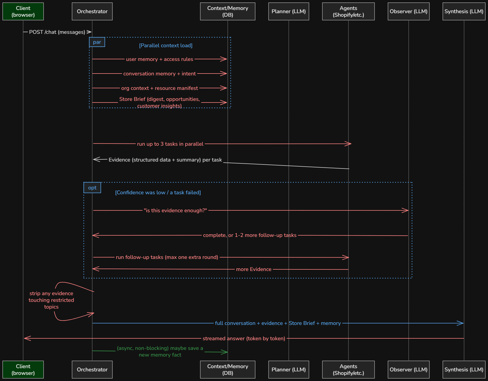

# auth4agents-llm-proxy

Long-running streaming proxy for the auth4agents chat completion call. The
Next.js frontend (Vercel) used to call the model provider directly via the AI
SDK `streamText`; we moved that one call here because Vercel caps streaming
at 800s and we have agentic workflows that will outlive that window.
Everything else — auth, DB writes, file upload, file description generation,
layer-1 question validation, title generation — stays in the Next.js app.

This server is **stateless**. There is no DB and no user session. Auth is per
request via a short-lived HMAC service token issued by the Next.js app.

The model provider is **OpenAI** via the AI SDK's `@ai-sdk/openai`
integration. Set `OPENAI_API_KEY` and `CHAT_MODEL` (e.g. `gpt-4o-mini`,
`gpt-4o`, `gpt-4.1-mini`).



## Endpoints

### `GET /health`
Returns `{ "ok": true }`. Used by Fly's HTTP health check.

### `POST /chat`
Headers
- `x-service-token: <payload>.<signature>` — required, HMAC-SHA256, 60s TTL
- `content-type: application/json`

Body
```json
{ "messages": UIMessage[] }
```

Response
AI SDK UI message stream, exactly as emitted by
`streamText(...).toUIMessageStreamResponse()`. Content-Type is
`text/event-stream`. The frontend tees this stream: one branch to the
browser, the other accumulated for DB persistence. Do not transform the
stream format.

## Service token

```
token     = <payload>.<signature>
payload   = base64url(JSON.stringify({ userId, orgId, conversationId, exp }))
signature = base64url(HMAC_SHA256(payload, LLM_PROXY_SECRET))
exp       = epoch-seconds (TTL = 60s recommended)
```

Both the Next.js app (signer) and this server (verifier) share
`LLM_PROXY_SECRET`. This server only verifies — it never issues tokens.

## Environment variables

| Var | Required | Default | Notes |
| --- | --- | --- | --- |
| `OPENAI_API_KEY` | yes | — | OpenAI API key |
| `CHAT_MODEL` | yes | — | OpenAI model id (e.g. `gpt-4o-mini`, `gpt-4o`) |
| `CHAT_MAX_OUTPUT_TOKENS` | no | `4096` | Cap for `streamText` |
| `ONTOLOGY_MODEL` | no | falls back to `CHAT_MODEL` | OpenAI model id used for ontology generation |
| `LLM_PROXY_SECRET` | yes | — | Shared HMAC secret with Next.js app |
| `PORT` | no | `8080` | Local + container listen port |
| `NEXT_JS_URL` | yes | — | Base URL of the Next.js app (webhook target) |
| `ALLOWED_ORIGINS` | no | `http://localhost:3000` | Comma-separated CORS origins |

Local dev uses `.env` (see `.env.example`). Production values live in Fly
secrets. Never commit `.env` or the secret.

## Local development

```
pnpm install
cp .env.example .env   # then fill in values
pnpm dev               # listens on :8080
curl http://localhost:8080/health
```

The `dev` script uses Node's built-in `--env-file=.env` flag, so no
dotenv dependency is needed.

### Test `/chat` with a hand-signed token

```
# In one shell:
pnpm dev

# In another shell:
TOKEN=$(pnpm -s sign-token user123 org456 conv789)

curl -N -X POST http://localhost:8080/chat \
  -H "x-service-token: $TOKEN" \
  -H "content-type: application/json" \
  -d '{"messages":[{"id":"1","role":"user","parts":[{"type":"text","text":"hello in one sentence"}]}]}'
```

You should see a streamed `text/event-stream` response in the client and on
the server a log line like:

```
[chat] finishReason= stop usage= { inputTokens: { total: 12 }, outputTokens: { total: 18 } }
```

## Deploying to Fly.io (Mumbai, `bom`)

First time:

```
fly launch --no-deploy --copy-config --name auth4agents-llm-proxy --region bom
fly secrets set \
  OPENAI_API_KEY=...   \
  CHAT_MODEL=gpt-4o-mini \
  LLM_PROXY_SECRET=... \
  CHAT_MAX_OUTPUT_TOKENS=4096
fly deploy
```

Subsequent deploys:

```
fly deploy
```

Verify:

```
curl https://auth4agents-llm-proxy.fly.dev/health
```

Important Fly config (already in `fly.toml`):
- `auto_stop_machines = false` and `min_machines_running = 1` — Fly will
  not suspend the machine mid-stream.
- `primary_region = "bom"` — Mumbai.
