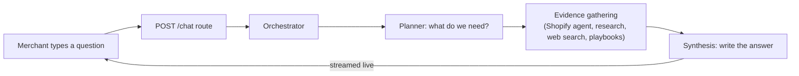
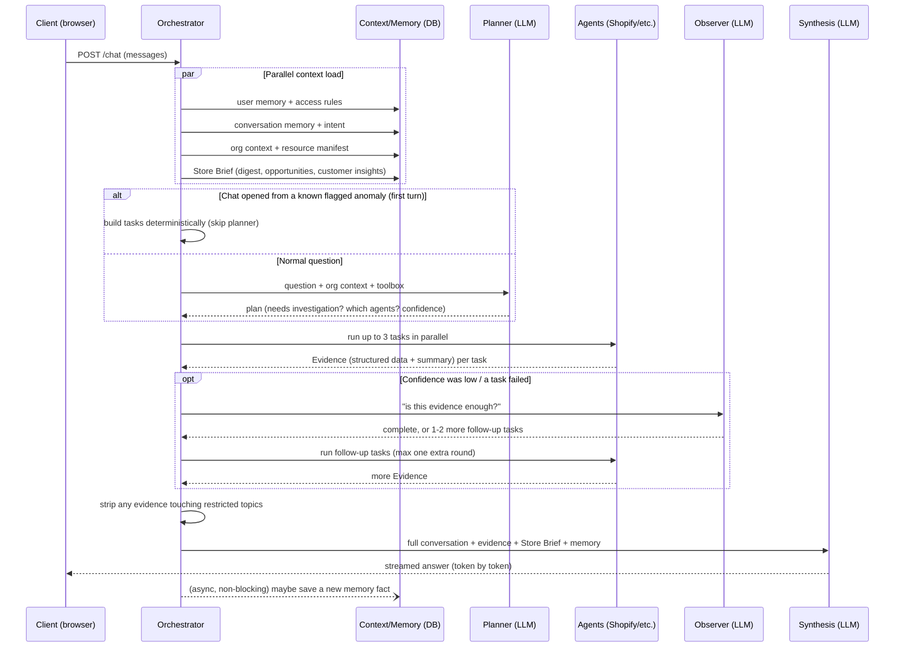
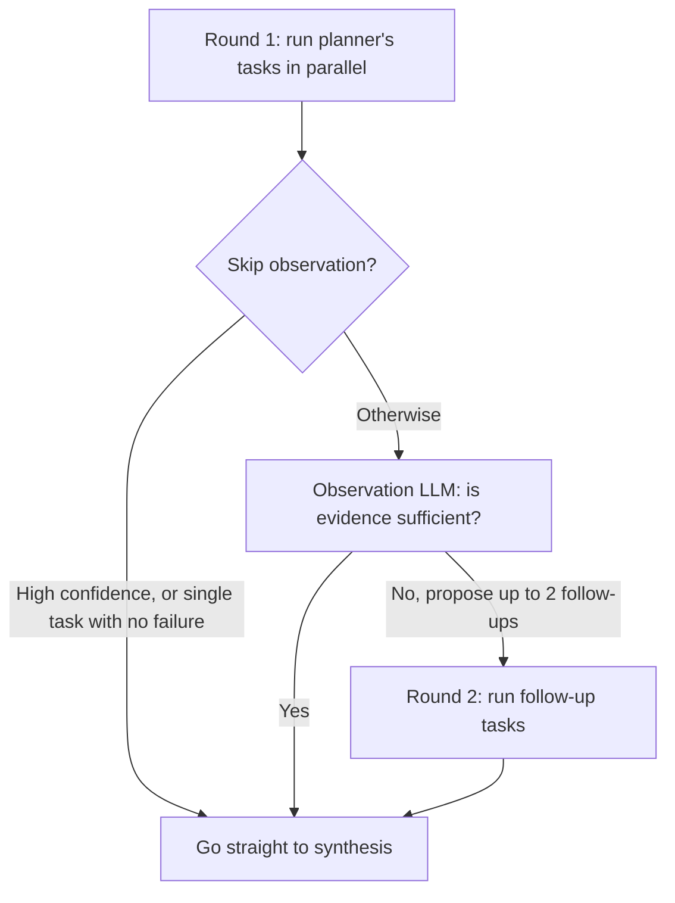
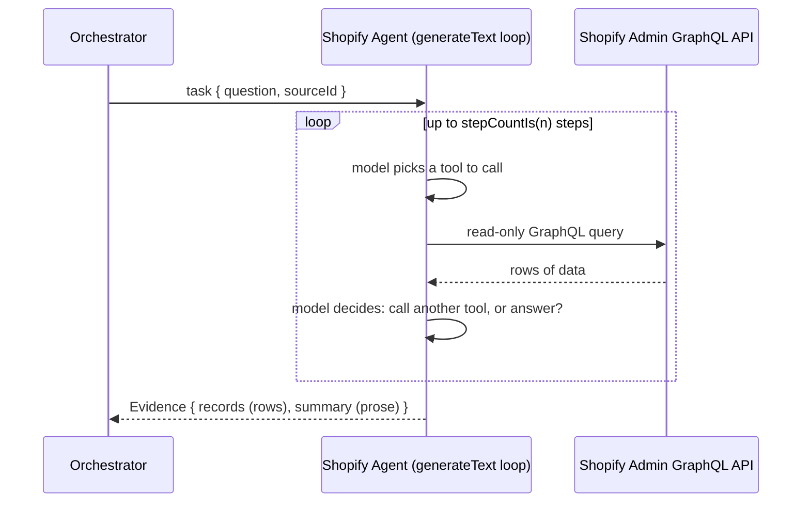
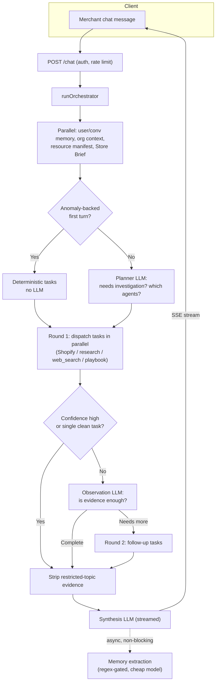

# How the Chat Orchestrator + Shopify Agent Work

*A plain-language walkthrough of `src/orchestrator/` and `src/agents/shopify/`, written for interview prep.*

---

## 1. The big picture

This backend powers a chat assistant for merchants using a Shopify analytics/support product. A merchant types a question like *"why did refunds spike last week?"* into chat, and the system needs to:

1. Figure out what data would actually answer that question.
2. Go fetch that data from Shopify (or other sources).
3. Write a grounded, store-specific answer — and stream it back live, like ChatGPT typing.

The **orchestrator** is the conductor. It doesn't know anything about Shopify itself — it just decides *who* to ask, collects what comes back, and writes the final answer. The **Shopify agent** is one of the specialists it can call — the one that actually knows how to talk to Shopify's API.



Think of the orchestrator as a **project manager**: it doesn't do the analytics itself, it delegates to specialists, checks their work is sufficient, then writes up the findings in a way the merchant can actually use.

---

## 2. The request lifecycle, step by step

**Entry point:** `POST /chat` in `src/index.ts`. This route:

1. Verifies a service token and pulls `userId`, `orgId`, `conversationId`, and `persona` (which "flavor" of assistant to use) from it.
2. Enforces a rate limit (so one user/org can't spam the LLM).
3. Calls `runOrchestrator(...)` — the one and only place this function is used in the whole codebase.
4. Streams the result back to the browser as **Server-Sent Events (SSE)** — a plain HTTP response that the client keeps reading as new chunks arrive, which is how the "typing" effect works.

Everything interesting happens inside `runOrchestrator`, in `src/orchestrator/index.ts`. It uses an AI SDK helper called `createUIMessageStream`, which gives you a `writer` you can push events onto — both the actual answer text *and* little side-channel status updates like `"investigating..."` or `"resources-used"` that the frontend uses to show a progress indicator, all multiplexed onto the same stream.

Here's the full sequence:



A few things worth noting about this flow:

- **The initial context load is parallelized** (`Promise.all`) — five independent lookups (user memory, conversation memory, org context, resource manifest, Store Brief) all fire at once rather than one after another, since none of them depend on each other.
- **Everything degrades gracefully.** If a DB call in the context-loading step fails, it's caught and returns an empty default rather than crashing the whole chat turn — a merchant with no analytics data yet still gets a working (if less-informed) chat experience.
- **Abort handling is threaded everywhere.** If the user closes the tab mid-answer, the request's `AbortSignal` is checked throughout, and the turn still finishes cleanly (logging what was generated so far) instead of hanging.

---

## 3. The Planner — deciding who to ask

File: `src/orchestrator/planner.ts`.

The planner is a single LLM call (`generateText` with a structured/JSON output schema, not free text) that reads the user's question plus a description of the "toolbox" available, and decides:

- `needsInvestigation` — is this even a question that requires fetching data? (Greetings and small talk get `false` — no need to call any agent.)
- `confidence` — will the tasks it's about to propose *fully* answer the question, or might we need a second look afterward?
- `tasks` — a list of `{ question, agentType, sourceId }` triples. `agentType` is one of `shopify | research | web_search | playbook`. `sourceId` picks *which* Shopify store, if the org has more than one connected.

**Where the "toolbox" comes from:** every agent type is registered once in an `AGENT_REGISTRY` array with a `routingRule` string describing when to use it (e.g. *"any question about the org's Shopify store: sales, revenue, orders, products, customers, inventory..."*). The planner's system prompt is built by concatenating all these routing rules — so adding a brand-new agent to the registry automatically teaches the planner when to use it, with zero changes to `planner.ts` itself. This is a nice example of a **registry pattern** keeping routing logic in one place instead of scattered `if` statements.

The planner also gets a **persona-specific lens** (e.g. a "Finance" persona nudges it to prioritize margin/refund questions, a "Growth" persona nudges toward acquisition/retention) and a **follow-up hint** on later turns in a conversation, so it doesn't re-investigate something already answered two messages ago.

**Shortcut — anomaly-backed chats.** If the merchant opened the chat directly from a flagged anomaly card (e.g. "refund rate spiked"), and this is the very first message, the planner is **skipped entirely**. Instead, a deterministic function (`getAnomalyTasks`) hardcodes the right investigation tasks for that anomaly type. This is faster, cheaper (no LLM call), and more reliable than hoping the planner infers the right follow-up from a vague first message.

Important: **the planner never calls any agent itself.** It only returns a plan. Dispatching the plan is a separate step (next section).

---

## 4. Context & governance — the guardrails

File: `src/orchestrator/context.ts`.

This file is a grab-bag of "things every LLM call needs to know, and things it must never do":

- **Org context** — the organization's name and business context, pulled from Postgres, truncated to a max length so it doesn't blow the prompt budget.
- **Resource manifest** — a plain-text list of what's actually available: which Shopify stores are connected (with their IDs, so the planner can pick a `sourceId`), which playbooks exist. If nothing is connected, it says so explicitly rather than pretending tools exist.
- **Governance prompt** — every user has an `allowedAccess`/`restrictedAccess` list (topics they're permitted or forbidden to discuss — think role-based data access). This gets turned into plain-English instructions injected into both the planner and synthesis prompts.
- **Restricted-evidence filtering** — a *second*, code-level safety net: after evidence comes back from agents, anything whose question/summary text matches a restricted keyword is dropped **before** synthesis ever sees it. This means even if an LLM ignored the governance instructions, the restricted content physically never reaches the final answer.

This two-layer approach (prompt instruction + code-level filter) is a recurring pattern in this codebase: **never trust the LLM alone to enforce a hard rule** — always back it with a deterministic check.

---

## 5. Evidence gathering & the observation loop

File: `src/orchestrator/evidence.ts`.

**"Evidence"** is the universal contract every agent must hand back, regardless of what kind of agent it is:

```ts
Evidence = {
  question: string;
  source: { type: 'shopify' | 'research' | 'web_search' | 'playbook' | 'unavailable', ... };
  records: Array<{ label, rowCount, rows }>;  // structured data
  summary: string;                             // the agent's own prose write-up
}
```

Having one shared shape means the orchestrator can treat a Shopify lookup and a web search identically when it comes time to hand everything to the synthesis step.

**Running tasks:** up to 3 tasks per round are dispatched **in parallel** (`Promise.all`) via a generic `routeToAgent(task)` function that looks up the right agent in the registry and calls it — the orchestrator doesn't know or care *how* the Shopify agent gets its answer, only that it returns `Evidence`. (For the anomaly-shortcut path, tasks run one at a time instead of in parallel, to avoid multiple investigations racing on a tightly-scoped issue.)

**The observation loop** is the "did we actually answer this?" check — a second, separate LLM call that looks at what evidence was gathered and judges whether it's sufficient, using explicit rules (e.g. *"a trend question needs both the current period and a prior period to compare against"*). If it's not satisfied, it proposes up to 2 more follow-up tasks, which get run the same way.



This loop is **deliberately bounded** to at most one extra round — it would be easy to let an LLM keep asking for "just one more piece of data" indefinitely, so the code hard-caps it rather than trusting the model's judgment about when to stop.

---

## 6. The Store Brief — pre-computed context so the model isn't starting cold

Files: `src/orchestrator/store-brief.ts` (pure rendering logic) and `src/orchestrator/store-intelligence.ts` (the DB fetch layer).

Think of the **Store Brief** as briefing notes handed to the model before it starts working: *"here's what's normal for this specific store, here's what's currently flagged as a problem, here's what customers have been saying lately."* Without this, the model would have no way to judge whether, say, a 6% refund rate is fine or alarming — it needs the store's own historical baseline to compare against.

It's built from three things that some other part of the system already computed, so this step is cheap:
- The latest **weekly digest** (revenue/orders/AOV, week-over-week deltas, a health score, "what's normal" baselines).
- Open **Opportunities** (previously flagged issues).
- Recent **customer insights** — deliberately using only the *analyst-generated summary*, never the raw customer message text, as a privacy precaution.

The code is split cleanly into a **pure function** (`assembleStoreIntelligence` — no database, just data-in/text-out, so it's fully unit-testable) and a **DB-fetching wrapper** around it. This is a nice, simple example of separating "logic" from "I/O" for testability. There are two output variants: a short one-liner for the planner (just enough to route correctly) and a rich block for synthesis and for the Shopify agent itself (so the specialist doing the digging also knows the store's context, not just the model writing the final answer).

---

## 7. Synthesis — writing the actual answer

File: `src/orchestrator/synthesis.ts`.

This is the final LLM call, and the only one that **streams** its output (using `streamText` instead of `generateText`) — its output is merged directly into the SSE stream going back to the browser, which is what the user actually sees appear on screen.

It takes: the full conversation history, all the Evidence gathered, the Store Brief, memory, governance rules, and picks one of three system-prompt shapes depending on the situation — an anomaly-specific one, a general "you're an operator who knows this store, ground every claim in evidence, lead with the most important insight, bold the headline number" one, or a bare-bones one for small talk with no evidence at all.

**A subtle but important detail:** when formatting evidence for this prompt, if an agent returned structured `records` (actual rows of data), those are used **instead of** the agent's own prose `summary`. The reasoning: don't make the synthesis model trust another model's book report — let it read the source numbers itself and draw its own conclusions. The summary text is only a fallback for evidence types that never produce structured rows.

---

## 8. Memory — lightweight sticky notes, not a transcript

File: `src/orchestrator/memory.ts`.

This is easy to misread as "the chat history" — it isn't. The actual conversation history is just the raw list of messages passed straight through from the frontend. This memory system is a much smaller, separate thing: short factual strings like *"prefers metric units"* or *"we already discussed the Q2 refund spike"*, stored as plain string arrays directly on the `User` and `Conversation` database rows (no vector DB, no embeddings).

Two scopes:
- **User memory** — persists across all future conversations.
- **Conversation memory** — scoped to just this one chat.

It's deliberately cheap: before ever calling an LLM, a regex checks the user's message and the start of the assistant's reply for trigger words like *"remember," "prefer," "from now on."* If neither matches, nothing happens — no LLM call at all. Only if triggered does a small, cheap model (independent from whichever model is answering the chat) decide whether to actually save something, and to which scope. Saved memories are capped at the last 10 entries per scope (simple FIFO eviction). This whole step runs **after** the answer has already been sent to the user (fire-and-forget), so it never adds latency to the response.

---

## 9. The Shopify Agent — the specialist

Folder: `src/agents/shopify/`.

This is the "specialist" the planner calls whenever a question needs real, live Shopify data — sales, orders, products, customers, inventory, refunds, discounts, fulfillment. It is **strictly read-only** and purely for answering analytics/business questions in chat.

> **Don't confuse it with the support agent.** There's a *separate* system in `src/support/` that drafts replies to customer emails/tickets and can take real write actions (cancel an order, edit an address) — but only behind a human-confirmation gate, with its own permission and audit-log system. That agent shares the same underlying Shopify API client, but is a completely different component, triggered by an inbound email, not by chat. The Shopify agent covered here never writes anything.

### How it's invoked

Same pattern as everything else in the orchestrator: the planner (or the anomaly shortcut) emits a task with `agentType: "shopify"`, `routeToAgent` looks it up in the registry, and calls `runShopifyAgent(task, context)`. It gets back one `Evidence` object and hands it to the rest of the pipeline exactly like any other agent's result — the orchestrator has no special-case code for Shopify specifically.

### Its tools

Internally, it makes **one** `generateText` call with access to about 13 tools, and the model decides which ones to call and in what order:

| Tool | Answers |
|---|---|
| `getShopOverview` | Basic store info: name, currency, plan |
| `getOrdersSummary` | Order count, total sales, discounts, AOV |
| `getOrdersTimeSeries` | Orders bucketed by day/week/month |
| `getTopProductsBySales` | Best-selling products by revenue |
| `listOrders` / `listProducts` / `listCustomers` | Real individual records (not aggregates) |
| `getInventoryLevels` | Stock levels, flags low/out-of-stock |
| `getCustomerRetentionStats` | New vs. returning customers, repeat-purchase rate |
| `getDiscountPerformance` | Discount code uptake and cost |
| `getFulfillmentSummary` | Unfulfilled orders, oldest first |
| `getRefundAnalysis` | Refund rate, top refunded products |
| `shopifyRawQuery` | Escape hatch — arbitrary **read-only** GraphQL for anything the typed tools don't cover |

### How the tool loop is bounded

This is a good interview detail: in older versions of the AI SDK, you'd pass a `maxSteps` option to cap how many times the model could call tools before answering. **That option doesn't exist in the version of the SDK this project uses.** Instead, the pattern is:

```ts
generateText({
  model,
  tools,
  stopWhen: stepCountIs(6),   // stop after 6 tool-calling steps
});
```

`stopWhen: stepCountIs(n)` tells the SDK to keep letting the model call tools and re-prompting it with results, automatically, until either it stops calling tools on its own or `n` steps have elapsed. This same pattern is used by the (separate) support agent too, just with a different step count — it's the house convention for bounding any agentic tool loop in this codebase.

There's also an **outer** loop one level up, unrelated to this: the orchestrator's own evidence round + observation cycle (section 5) can call the Shopify agent more than once across separate rounds — that's a different, coarser loop than the one *inside* a single Shopify agent call.

### Guardrails, layered

- **Prompt-level:** explicit instructions to report only what tool results actually contain, say "0 rows" plainly rather than guessing, and never present made-up numbers as live data.
- **Code-level, not just prompt-level:** if *every* tool call in a run fails, the code overrides whatever text the model produced and force-returns a fixed "data unavailable" message — this can't be bypassed by a clever prompt, because it's a check on actual tool results, not on the model's output.
- **Transport-level:** the shared GraphQL client hard-rejects any query string containing the word `mutation` before it's ever sent to Shopify — defense in depth, even though nothing in this agent's code path should ever try to write.
- **Pagination ceilings:** aggregate queries stop after a fixed number of pages (e.g. 2000 orders) and flag the result as `truncated` so the model tells the user the number might be a lower bound, rather than silently under-counting.
- **Timeouts:** every Shopify API call has a hard timeout so one slow request can't hang the whole chat turn.

### Where the data actually comes from

There's **no local copy of Shopify's data** in this system's own database — no `Order`, `Product`, or `Customer` tables. Every number is fetched **live** from Shopify's Admin GraphQL API at request time, then aggregated in memory (e.g. summing line items to rank top products). The only thing stored locally is the *encrypted OAuth credential* used to authenticate to Shopify, plus some cached shop metadata (name, currency, plan). This is a deliberate trade-off: always-fresh data, at the cost of live API latency and Shopify's own rate limits on every question.



### What it hands back

One `Evidence` object: the raw structured rows it collected (used by the "prefer numbers over prose" rule described in section 7), a prose summary as a fallback, and token-usage numbers for cost tracking. The orchestrator aggregates which stores/tools contributed into a small "resources used" list shown in the UI, so the merchant can see what backed the answer.

---

## 10. Putting it all together



**LLM call budget per chat turn:** typically 2 (planner + synthesis) up to 4 (planner, observation, synthesis, memory) — plus however many internal tool-calling steps the dispatched agents use (e.g. the Shopify agent's own bounded loop). The system is designed so most of these calls are skippable in the common case: anomaly-backed turns skip the planner, high-confidence plans skip observation, and most turns skip memory extraction entirely because the regex gate doesn't fire.

---

## 11. Interview Q&A

**Q: Walk me through what happens when a user sends a chat message.**
The request hits `POST /chat`, gets authenticated and rate-limited, then `runOrchestrator` takes over. It loads context (memory, org info, available tools, Store Brief) in parallel, runs a planner LLM call to decide if/what to investigate, dispatches tasks to specialist agents (like the Shopify agent) in parallel, optionally runs one more "is this enough?" check, filters out anything restricted, then a final synthesis LLM call streams the actual answer back over SSE. A memory-extraction step may run afterward, asynchronously.

**Q: Why is there both a planner call and a separate observation call — isn't that redundant?**
They answer different questions. The planner asks "what should we look at first?" before any data exists. The observer asks "given what we found, is it actually enough to answer the question?" — a judgment that's only possible after seeing real results (e.g. a task might come back empty, or reveal the question needs a comparison period the plan didn't request). Splitting them also means the more expensive follow-up check can be skipped entirely when the planner was already confident, which keeps most requests to a single round.

**Q: How do you bound an LLM tool-calling loop in AI SDK v6, since `maxSteps` isn't available anymore?**
You pass `stopWhen: stepCountIs(n)` to `generateText`/`streamText` when tools are involved. The SDK keeps automatically feeding tool results back to the model and re-prompting until the model stops calling tools on its own, or the step count hits `n`, whichever comes first. It's a predicate-based replacement for the old numeric option, and this codebase uses it consistently for both the Shopify agent and the separate support agent.

**Q: How does the system avoid presenting hallucinated numbers as real data?**
Multiple layers: the tool-calling agents are instructed to only report what tool results actually contained; if every tool call in a run fails, the code itself (not the model) overrides the output with a fixed "data unavailable" message; and downstream, the synthesis step prefers structured data rows over any agent's free-text summary, so a hallucinated sentence can't sneak into the final answer if real rows are available to check it against.

**Q: What's the difference between the Shopify agent and the support agent?**
The Shopify agent (`src/agents/shopify/`) is a read-only analytics specialist used by the chat orchestrator to answer business questions — it can never write anything, enforced even at the network transport layer. The support agent (`src/support/`) is a completely separate system that drafts replies to customer emails and *can* take real actions like canceling an order, but only through a deny-by-default permission system with human-confirmation gates and an audit log. They share the underlying Shopify API client and credentials, but are triggered differently (chat vs. inbound email) and serve different audiences (merchant vs. customer).

**Q: Why precompute a "Store Brief" instead of just letting the model call more tools to figure out what's normal?**
Two reasons: cost/latency (the digest, opportunities, and customer insights are already computed by other jobs, so reusing them is free versus re-deriving baselines every chat turn), and quality — without a baseline, the model has no way to judge whether a given number is good or bad for *this specific store*. Precomputing it also lets the planner see a cheap summary before deciding what to investigate, rather than needing an extra round trip just to establish context.

**Q: How would you add a new specialist agent to this system, say for ad spend data?**
Register it once in `AGENT_REGISTRY` with a `type`, a `routingRule` string describing when the planner should pick it, and a `run` function that takes a task and returns an `Evidence` object. Because the planner's prompt and the resource manifest are both generated from that registry automatically, no other file needs to change for basic routing to work — you'd only touch `evidence.ts`/`router.ts` if the new agent needed special dispatch behavior beyond the standard task-in/evidence-out contract.

**Q: What happens if Shopify's API (or the database) is slow or down mid-request?**
Every DB-backed context function fails soft — catches errors, logs them, and returns an empty default rather than throwing, so a single flaky lookup degrades the chat (less context) instead of breaking it. The Shopify agent has per-call timeouts on its API calls, and if every tool call fails, it returns a clear "data unavailable" evidence result rather than presenting stale or fabricated data as if it were live.

**Q: Why gate the memory-extraction LLM call behind a regex instead of just running it every turn?**
Cost and latency. Most turns don't contain anything worth remembering, so running an LLM call on every single message would burn tokens for no benefit. A cheap regex check for trigger words ("remember," "prefer," "from now on," etc.) filters out the vast majority of turns before any model is invoked, and the actual extraction call — when it does run — uses a separate, cheaper model than the one answering the user, and runs after the response has already been sent so it never adds latency.

**Q: How is streaming actually implemented — what's going over the wire?**
The response is `text/event-stream` (SSE). There are two layers: an outer stream (`createUIMessageStream`) that the orchestrator writes custom status events onto (like "investigating..." or "resources-used"), and an inner stream produced by the synthesis step's `streamText` call, which is merged into the outer one so the actual answer tokens and the status events share a single connection back to the browser.

**Q: Why fan out up to 3 tasks in parallel instead of one at a time?**
Because most investigation tasks are independent of each other — e.g. checking inventory and checking refund rate don't depend on each other's results — so running them concurrently cuts total latency roughly to the slowest single task instead of the sum of all of them. The cap of 3 keeps the system from firing off an unbounded number of expensive agent calls if the planner (or a misbehaving observation round) proposes too many at once.
